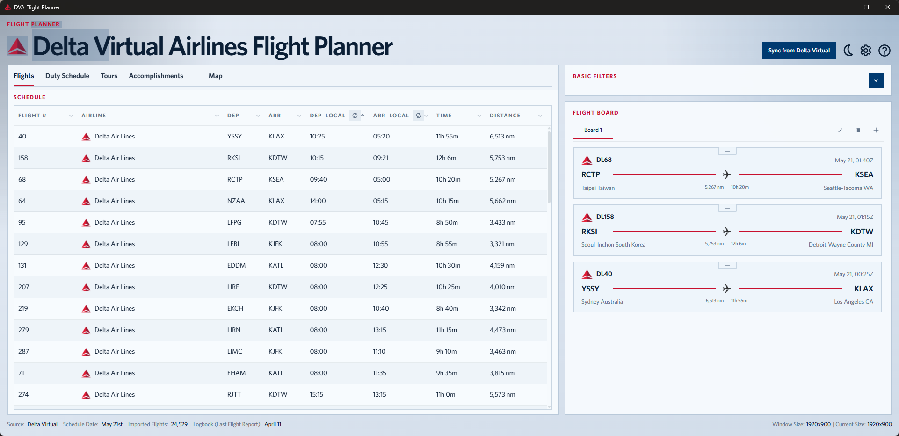
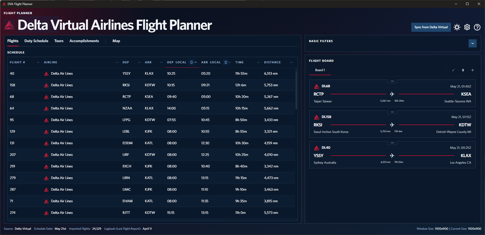
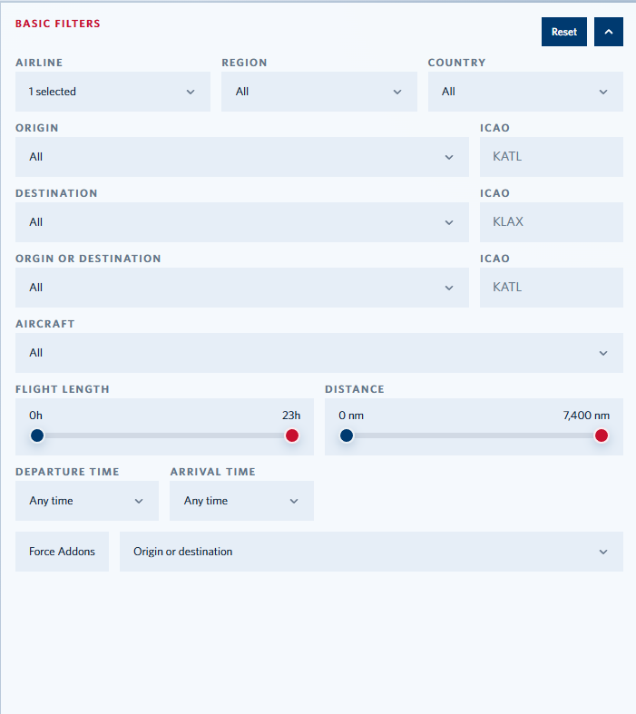
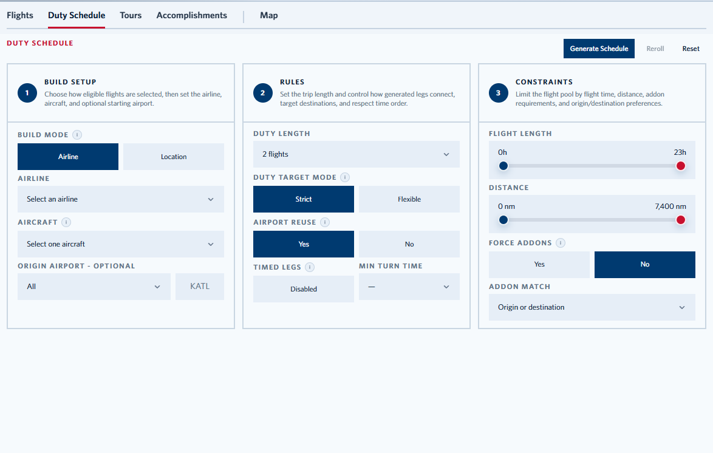
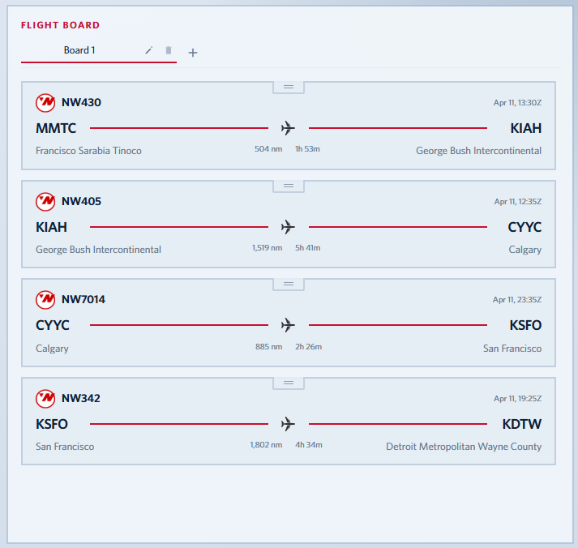
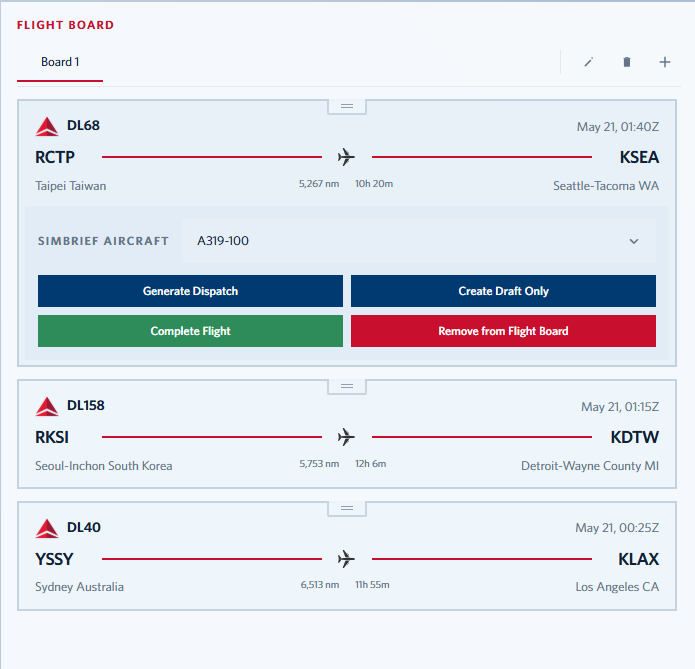
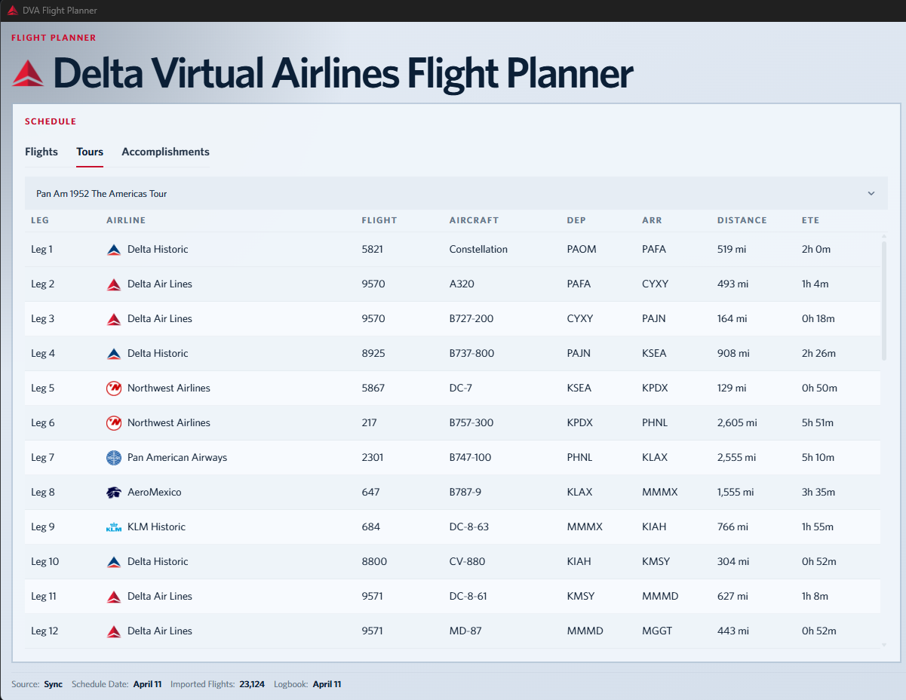
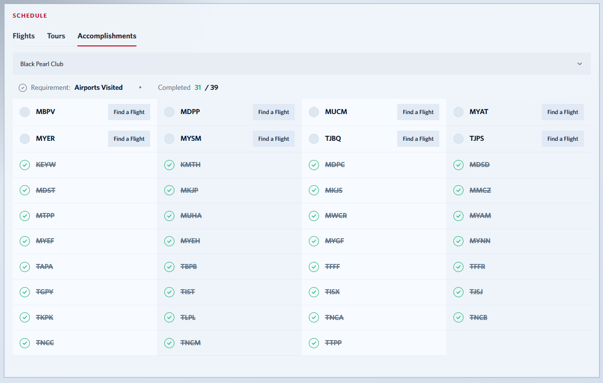
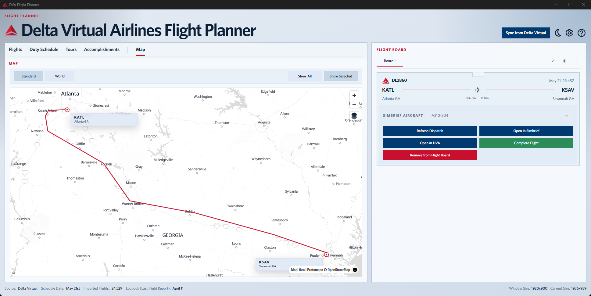

# Delta Virtual Airlines Flight Planner

Desktop flight planning and operations tool for Delta Virtual Airlines pilots.

Flight Planner helps you sync your DVA schedule, review logbook progress, build routes, prepare SimBrief dispatches, and manage planned flights from one Windows desktop app.

<table>
  <tr>
    <td align="center">
      
    </td>
    <td align="center">
      
    </td>
  </tr>
</table>

## Disclaimer

*For flight simulation purposes only. This is not a commercial application and is not affiliated with Delta Air Lines, Delta Virtual Airlines, their affiliates, or any other airline. Logos, images, and trademarks remain the property of their respective owners.*

## Major Features

- Sync the current Delta Virtual Airlines schedule, tours, and logbook data.
- Find flights by airline, airport, region, country, scheduled aircraft type, local time, duration, distance, addon scenery, and live VATSIM coverage.
- Build connected duty schedules by airline or location.
- Maintain up to four persistent Flight Boards for planned routes, tours, and trip ideas.
- Generate, refresh, and open SimBrief dispatches from Flight Board entries.
- Create, update, open, and delete DVA draft flight reports from the app.
- Track Delta Virtual tour progress and accomplishment airport progress.
- Review synced logbook entries and Pilot Stats.
- View planned routes on an interactive map with weather, satellite, and VATSIM-aware overlays.
- Choose light or dark mode and save your settings, addon folders, and custom SimBrief airframes.

## Windows SmartScreen

Windows may show a `Microsoft Defender SmartScreen` warning when opening the app's `.exe`.

To continue, click `More info`, then `Run anyway`.

## Quick Start

1. Open the app and follow `Getting Started`.
2. Save your DVA first name, last name, and password, then your SimBrief Navigraph alias and Pilot ID. Add your simulator's Addon/Community folders or choose `Skip Addon Setup`. Click `Finalize Boarding` when setup is complete. You can also skip setup and configure these details later in `Settings`.
3. Click `Sync from Delta Virtual`.
4. Use `Flights`, `Duty Schedule`, `Tours`, `Accomplishments`, `Map`, or `Logbook` depending on what you want to plan or review.
5. Add schedule rows or tour legs to a Flight Board.
6. Expand a Flight Board entry, choose its aircraft and network, then use `Generate Dispatch` or `Create Draft Only`.

Use the sun/moon button to switch themes, the gear button for `Settings`, and the question-mark button to reopen this guide.

## Main Workflows

### Delta Virtual Sync

`Sync from Delta Virtual` signs into DVA in the background and refreshes the local schedule, tour data, and logbook data used by the app.

The app also supports a separate `Refresh Logbook` action from the Logbook view when you only need updated logbook and Pilot Stats data.

Sync again when you want the latest DVA schedule or tour information. A `Schedule Out of Date` warning still allows you to add flights to a board; sync before relying on those flights for current planning.

If a logbook refresh fails, the app keeps your saved logbook. Try `Refresh Logbook` again. For sign-in problems, check your saved details under `Settings` > `Delta Virtual`; `Reset DVA Sync Session` lets you start a fresh sign-in session.

### Schedule Planning

Use `Flights` to search and sort the schedule. Search for airports by name or enter an ICAO/IATA code, then double-click a flight to add it to the active Flight Board.

- Departure and arrival times, including time-of-day filters, use each airport's **local time**.
- The `Aircraft` filter matches the type listed in the schedule. Selecting one type does not include other types simply because they could fly the route.
- Enable `Force Addons` to require detected scenery at departure, arrival, either, or both. Configure and scan your scenery folders in `Settings` > `General` first.
- Enable `VATSIM` and choose the coverage you want at departure or arrival.
- On shorter windows, open `More filters` to reach the time, VATSIM, and addon controls.

  

### Duty Schedule

`Duty Schedule` builds connected legs and places the result on the active Flight Board. Choose an airline, or use Location mode to let the app select an eligible airline for a country or region. You can set an optional aircraft and starting airport, number of legs, airport reuse, addon matching, and route constraints.

Use `Strict` to require the requested number of legs or `Flexible` to allow a shorter result. Enable `Timed Legs` to require departures after the previous arrival plus your minimum turn time. Review the overwrite confirmation if the active board already contains flights.

<table>
  <tr>
    <td align="center">
      
    </td>
    <td align="center">
      
    </td>
  </tr>
</table>

### Flight Boards

Keep up to four Flight Boards for separate plans. Use the plus button to add a board, the pencil to rename it, and the trash button to delete it. Select a board before adding flights; on narrower windows, use the arrows to switch boards. Boards are saved between app sessions, and flights can be dragged into a different order.

Expand an entry to choose aircraft, prepare a dispatch or draft report, mark a flight complete locally, or remove it. `Complete Flight` updates your local planning status; submit your actual flight report through DVA. Use `Click to Revert Status` to undo a local completion.

After a schedule refresh, an entry that no longer matches may show `Repair`. Use it to try to reconnect the entry to the current schedule, or remove the entry and choose another flight.

  

### Tours and Accomplishments

Tours are synced from Delta Virtual and displayed as ordered tour legs. Tour legs can be added to a Flight Board and marked complete locally.

Accomplishments use synced DVA logbook data to track required airport progress and help find eligible flights. Refresh your logbook after submitting a pilot report (PIREP) or after its status changes so progress reflects DVA's latest records. Submitted reports count toward planning progress; rejected reports become eligible again.

<table>
  <tr>
    <td align="center">
      
    </td>
    <td align="center">
      
    </td>
  </tr>
</table>

### Logbook and Pilot Stats

Open `Logbook` and switch between `Flights` for searchable flight records and `Pilot Stats` for totals, airline and aircraft breakdowns, favorite routes, airport visits, recent landings, and records.

In `Pilot Stats`, use `Filter` to view `All`, `Last 30 Days`, `Last 90 Days`, `Year to Date`, or an available logbook year. Use `View all` on a stats card to explore its full breakdown.

Flight numbers in the logbook and Pilot Stats detail views can be clicked to open the matching PIREP on the DVA website.

### Map View

The map shows routes for the active Flight Board, with options to view all board flights or only the selected flight. A generated SimBrief plan adds its route and waypoints. Use the layer controls for `Satellite`, `Wx` (weather radar), `Labels`, and `Live ATC` (VATSIM coverage). Standard and World map modes provide different views of the route.

  

### SimBrief and Draft Reports

Expand a Flight Board entry and select the aircraft and network before dispatching:

- `Generate Dispatch` prepares a SimBrief plan and creates or updates the matching DVA draft flight report.
- `Refresh Dispatch` retrieves the latest saved SimBrief plan and updates the draft. Use this after editing the plan in SimBrief.
- `Regenerate Dispatch` generates a new plan when you want to start over.
- `Create Draft Only` creates a DVA draft without SimBrief; `Update Draft Only` saves later changes to that draft.
- Use the available SimBrief and DVA links to review the result. `Delete DVA Draft` removes the linked draft after confirmation. If prompted afterward, regenerate the dispatch before continuing.

In `Settings` > `SimBrief`, choose `LBS` or `KGS`, a dispatch time source (`Schedule UTC` or `Current UTC`), and an optional departure offset. Dispatch times use UTC even though schedule tables display local times.

For a custom SimBrief airframe, add its internal ID, a name, and `Matching Aircraft` in the same settings page. This links the airframe to the DVA aircraft used for draft reports. If a saved airframe shows `Relink required`, remove it and add it again with a matching aircraft.

## Settings

Open the gear button to manage:

- `General`: addon airport folders and scans.
- `Delta Virtual`: your DVA first name, last name, password, and sync session reset.
- `SimBrief`: Navigraph alias, Pilot ID, units, dispatch time source, departure offset, and custom airframes.
- `Advanced`: `Check for Updates` and `Delete User Data`.
- `About`: app version, project links, contact information, and What's New.

## Data and Privacy

Your downloaded schedule, logbook, tours, settings, and Flight Boards are saved on your device. Internet access is needed to sync DVA data, use SimBrief, and load live map information.

Use `Settings` > `Advanced` > `Delete User Data` to clear saved app data and DVA login details from this device. This also removes your saved Flight Boards and settings; you will need to configure the app and sync again.
